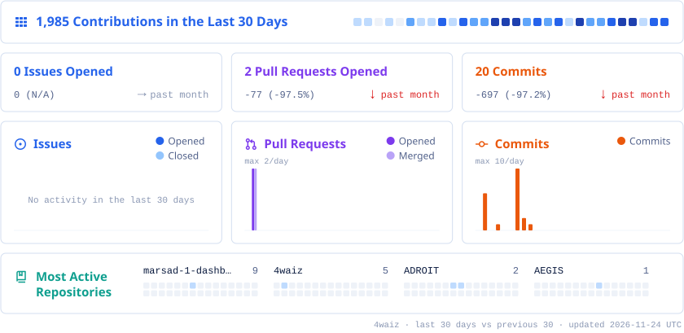
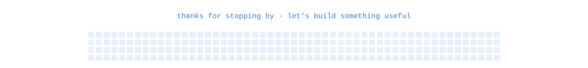

<picture>
  <source media="(prefers-color-scheme: dark)" srcset="https://skillicons.dev/icons?i=py%2Cts%2Cjs%2Ccs%2Cdart%2Ccpp&theme=dark" />
  
</picture>
 
<picture>
  <source media="(prefers-color-scheme: dark)" srcset="https://skillicons.dev/icons?i=pytorch%2Ctensorflow%2Csklearn%2Copencv%2Cfastapi&theme=dark" />
  
</picture>
 
<picture>
  <source media="(prefers-color-scheme: dark)" srcset="https://skillicons.dev/icons?i=react%2Cnextjs%2Csvelte%2Cthreejs%2Ctailwind%2Cnodejs&theme=dark" />
  
</picture>
 
<picture>
  <source media="(prefers-color-scheme: dark)" srcset="https://skillicons.dev/icons?i=unity%2Cblender%2Cflutter%2Cros%2Craspberrypi%2Carduino&theme=dark" />
  
</picture>
 
<picture>
  <source media="(prefers-color-scheme: dark)" srcset="https://skillicons.dev/icons?i=docker%2Ckubernetes%2Cazure%2Caws%2Ccloudflare%2Cvercel%2Csupabase%2Cpostgres&theme=dark" />
  
</picture>

  

## 📊 GitHub Stats

<picture>
  <source media="(prefers-color-scheme: dark)" srcset="https://raw.githubusercontent.com/4waiz/4waiz/main/assets/stats/stats-dark.svg" />
  
</picture>

## 🤝 Let's build something

I'm open to conversations with engineers, researchers, founders and teams working on applied AI, robotics, digital twins and Industry 5.0, especially products that need to ship, not just demo.

  

