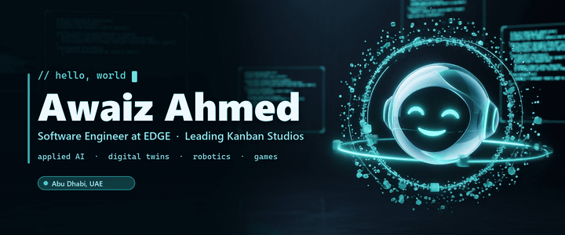
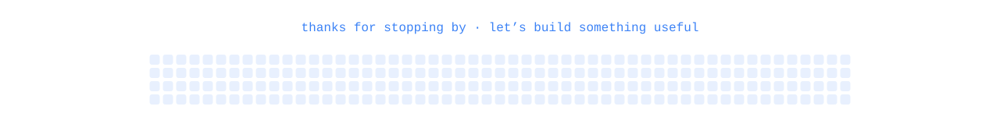

<!-- Awaiz Ahmed · GitHub profile · github.com/4waiz -->

<a href="https://kanbanstudios.com/awaiz">
  <picture>
    <source type="image/avif" srcset="https://raw.githubusercontent.com/4waiz/4waiz/main/assets/banner/banner.avif?v=rabt" />
    <source type="image/webp" srcset="https://raw.githubusercontent.com/4waiz/4waiz/main/assets/banner/banner.webp?v=rabt" />
    
  </picture>
</a>

  
  
  
  

  
  
  
  

## 🧭 About me

I'm a software engineer at **EDGE** in Abu Dhabi and I lead **Kanban Studios**. I build applied AI, robotics, digital twins and games, and I like taking a prototype all the way to software people can actually use.

| Now | Where |
| --- | --- |
| Software Engineer, Industry 5.0 & Emerging Technologies | **EDGE · BRIDGE** · since Nov 2025 |
| Leading the studio: software and AI for UAE businesses, plus Team Kanban, its hackathon squad | **Kanban Studios** |
| BSc Software Engineering · undergraduate researcher | **Al Ain University** |
| Global AI Delegate to the UAE | **Global Alliance for AI** · since Jun 2026 |
| Organiser, DevFest Abu Dhabi 2026 | **Google Developer Groups Abu Dhabi** |
| Certified Innovator (VIA26) and Certified Trainer | **Google for Education** |

## 🛠️ Selected work

| Project | What it does | Built with | Status |
| --- | --- | --- | --- |
| [**Kanban Agents**](https://github.com/4waiz/kanban-agents) | No-code 3D office playground for designing and running Gemini-powered agent teams | Three.js · WebGPU · React Flow · Gemini | [Live](https://4waiz.github.io/kanban-agents/) |
| [**IntentGate Z**](https://github.com/4waiz/IntentGateZ) | Gateway on IBM LinuxONE that checks AI agent actions against signed human intent | IBM LinuxONE · Telum NNPA · React · Three.js | IBM Z Datathon 2026 |
| [**AeroHalo**](https://github.com/4waiz/AeroHalo) | Predictive airside safety: flags vehicle-to-aircraft collisions seconds before they happen | React Three Fiber · edge AI · computer vision · Arduino UNO Q | 🥇 INSPIRE ’26 |
| [**DAPPER**](https://github.com/4waiz/Dapper) | Deadline-aware scheduler placing each robot perception frame on board, at the edge or both | Python · edge offloading · pytest | 📄 IEEE FMEC 2026 |
| [**Encirra**](https://github.com/4waiz/Encirra) | Digital twin that simulates cascading power-water failures and verifies safer urban recovery plans | pandapower · EPANET (WNTR) · React Three Fiber | IEEE NEECON 2026 |
| [**AquaTwin**](https://github.com/4waiz/AquaTwin) | Physics-informed digital twin recommending safety-checked operating strategies for desalination plants | Next.js · gradient-boosted trees · conformal prediction | KU × UNESCO Water Hackathon |

<b>Six more projects</b>

 

| Project | What it does | Built with | Status |
| --- | --- | --- | --- |
| [**CONTINUA**](https://github.com/4waiz/CONTINUA) | Predictive connectivity prototype keeping a rover's control, telemetry and video alive across networks | TypeScript · Next.js · Python · network simulation | EDGE Challenge ATP2026 |
| [**Rafeeq**](https://github.com/4waiz/Rafeeq-library) | Autonomous TIAGo Pro robot that finds, grasps and delivers library books in simulation | ROS 2 · TIAGo Pro · Python · Docker | Emirates Robotics Competition 2026 |
| [**BeBTR**](https://github.com/4waiz/BeBTR) | On-device computer vision that coaches exercise form and flags injury risk live | computer vision · pose estimation · on-device AI | 🥇 Smart Health Hackathon |
| [**KanDelta**](https://github.com/4waiz/kandelta) | Shows brands and creators where video audience response outpaces creator supply | Next.js · TypeScript · Oriane | 🥇 Oriane × Replit |
| [**The Twelfth Stamp**](https://github.com/4waiz/12th-Stamp) | Psychological horror across eleven countries, playable in a browser, on Quest 3 or in PC VR | Unity 6 · C# · WebXR · OpenXR | [Play on itch.io](https://4waiz.itch.io/the-twelfth-stamp) |
| [**SKYFOLD**](https://github.com/4waiz/skyfold) | Nonviolent puzzle-adventure for PC and Quest 3 VR about repairing a miniature coastal city | Unity 6 (URP) · OpenXR · C# | PC · Quest 3 |

Every build, ranked by complexity, with demos and videos: <a href="https://kanbanstudios.com/awaiz"><b>kanbanstudios.com/awaiz</b></a>

## 🏆 Results

22 competition wins by my own count across 30+ hackathons.

<b>Top results</b>: 🥇 AI Everything Abu Dhabi · 🥇 INSPIRE ’26 · 🥇 Oriane × Replit · 🥇 Replit × IEC · 🥇 Smart Health · 🥇 CTRL Game Jam

 

| | Result | Event | Build |
| :-: | --- | --- | --- |
| 🥇 | 1st place | AI Everything Abu Dhabi Hackathon · Alibaba Cloud, Qoder & ZAKA · Oct 2026 | UnderGrid |
| 🥇 | 1st place | INSPIRE ’26 Arduino UNO Q Hackathon · IEEE SSCS AUS · University Track, 100+ teams · Sep 2026 | [AeroHalo](https://github.com/4waiz/AeroHalo) |
| 🥇 | 1st of 48 teams | Oriane × Replit Hackathon · with Team Kanban · Sep 2026 | [KanDelta](https://github.com/4waiz/kandelta) |
| 🥇 | 1st place | Replit × IEC Buildathon · MBZUAI Incubation & Entrepreneurship Center · Jun 2026 | [Starkz AI](https://github.com/4waiz/replit) |
| 🥈 | 2nd place | Safe AI Cup 2026 · University of Dubai · University Track · Jun 2026 | [BridgeLab AI](https://github.com/4waiz/BridgeLabAI) |
| 🥈 | 2nd place | Universities Hackathon: Farm to Market · Ministry of Climate Change & Environment · Apr 2026 | [SooqRoot](https://github.com/4waiz/SooqRoot) |
| 🥇 | 1st place | Smart Health Hackathon · Department of Health Abu Dhabi & startAD · AED 20,000 · Apr 2025 | [BeBTR](https://github.com/4waiz/BeBTR) |
| 🥇 | 1st place | CTRL Game Jam · Abu Dhabi Gaming · AED 30,000 · Nov 2024 | |

<b>More documented results and recognitions</b>

 

| | Result | Event | Build |
| :-: | --- | --- | --- |
| 🥉 | 3rd place | Cyberthorn 2026 · Creative Lab, BITS Pilani Dubai · Oct 2026 | AURO/GEN A30 |
| 🎬 | Best Film Award | AI Microfilm Challenge Dubai 2026 · UAE AI Builder Community & Vidu AI · Oct 2026 | No Rush |
| 🏆 | Winner | Hult Prize 2026 · university round | [EcoLens AI](https://github.com/4waiz/EcoLens) |
| 🥉 | 3rd place | c0mpiled-2 UAE Hackathon · Transpose Platform at Yas Marina Circuit · Feb 2026 | [DeedFlow](https://github.com/4waiz/DeedFlow) |
| 🥇 | 1st place | Heritage Innovation Hackathon · Al Ain University & Sandooq Al Watan · Nov 2025 | [Heritage Pearl Quest 3D](https://github.com/4waiz/PearlDiver3D) |
| 🌟 | Most Promising Idea | NASA Space Apps Challenge Dubai 2025 · international nominee · Nov 2025 | [Meteor Madness](https://github.com/4waiz/nasa-meteor-project) |
| 🥇 | 1st place | EDGE Industry Challenge 2025 · Make it in the Emirates · May 2025 | FalconPatrol AI |
| 🥉 | 3rd place | Digital Transformation Hackathon · Zayed University with Dubai Customs · Feb 2025 | DocuMaster |
| 🏆 | Best Overall Game | UAE Game Makers Game Jam 2024 · Endless Studios, Tawazun Council & SPACE42 · Oct 2024 | Falcon’s Odyssey |
| 🎖️ | Top 16 | JetBrains × 42 Abu Dhabi Student Hackathon · Oct 2026 | PluginFence |
| 🎖️ | Top 12 | BitNBuild UAE by GDSC · Sep 2026 | OverSight |
| 🎖️ | Finalist | Global Build Challenge · Bridge the Gap track · Apr 2026 | [Common Ground](https://github.com/4waiz/Audience-Lens) |
| 🎖️ | Top 170 of 4,710 | Create Apps Championship · Dubai Chamber of Digital Economy · Feb 2026 | [XPBridge](https://github.com/4waiz/XpBridge) |

## 📄 Research

<b>Keeping Engineers in the Loop: Explainable Requirement Defect Screening Across Software Requirements Specifications</b> · IEEE HCARE 2026 · <i>published</i>

 

Co-located with RE’26 in Montréal · with Mohammad Umer, supervised by Dr Khubaib Amjad Alam 
9,165 requirements screened: 0.855 accuracy and 0.891 macro-F1, with explanations an engineer can check. 
[Paper](https://ieeexplore.ieee.org/document/11677830) · [Reproducibility package](https://github.com/4waiz/hcare2026_awaiz)

<b>DAPPER: Deadline-Aware Edge Perception for Mission-Critical Robots under Dynamic Network Conditions</b> · IEEE FMEC 2026 · <i>accepted</i>

 

The 11th Conference on Fog and Mobile Edge Computing · with Dr Khubaib Amjad Alam 
Places each robot perception frame on board, at the edge or both, to meet its deadline. 
[Project page](https://4waiz.github.io/Dapper/) · [Code](https://github.com/4waiz/Dapper)

## 🧰 Toolbox

<picture>
  <source media="(prefers-color-scheme: dark)" srcset="https://skillicons.dev/icons?i=py%2Cts%2Cjs%2Ccs%2Cdart%2Ccpp&theme=dark" />
  
</picture>
 
<picture>
  <source media="(prefers-color-scheme: dark)" srcset="https://skillicons.dev/icons?i=pytorch%2Ctensorflow%2Csklearn%2Copencv%2Cfastapi&theme=dark" />
  
</picture>
 
<picture>
  <source media="(prefers-color-scheme: dark)" srcset="https://skillicons.dev/icons?i=react%2Cnextjs%2Csvelte%2Cthreejs%2Ctailwind%2Cnodejs&theme=dark" />
  
</picture>
 
<picture>
  <source media="(prefers-color-scheme: dark)" srcset="https://skillicons.dev/icons?i=unity%2Cblender%2Cflutter%2Cros%2Craspberrypi%2Carduino&theme=dark" />
  
</picture>
 
<picture>
  <source media="(prefers-color-scheme: dark)" srcset="https://skillicons.dev/icons?i=docker%2Ckubernetes%2Cazure%2Caws%2Ccloudflare%2Cvercel%2Csupabase%2Cpostgres&theme=dark" />
  
</picture>

  

## 📊 GitHub Stats

<picture>
  <source media="(prefers-color-scheme: dark)" srcset="https://raw.githubusercontent.com/4waiz/4waiz/main/assets/stats/stats-dark.svg" />
  
</picture>

## 📈 Activity

<picture>
  <source media="(prefers-color-scheme: dark)" srcset="https://streak-stats.demolab.com?user=4waiz&background=0D1117&border=1E2A4A&stroke=1E2A4A&ring=3B82F6&fire=60A5FA&currStreakNum=F5F8FF&sideNums=F5F8FF&currStreakLabel=93C5FD&sideLabels=93A6CC&dates=7D8DB0&hide_border=true" />
  
</picture>

<picture>
  <source media="(prefers-color-scheme: dark)" srcset="https://raw.githubusercontent.com/4waiz/4waiz/output/snake-dark.svg" />
  
</picture>

## 🤝 Let's build something

I'm open to conversations with engineers, researchers, founders and teams working on applied AI, robotics, digital twins and Industry 5.0, especially products that need to ship, not just demo.

  

